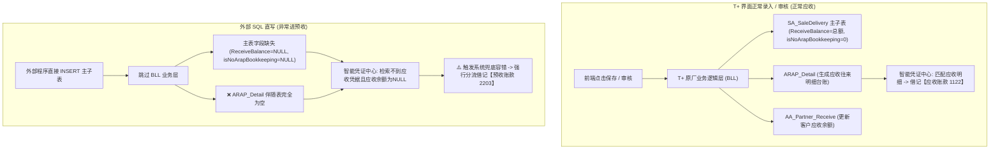

# 畅捷通 T+ 销售单生成凭证科目异常分析与排查技术手册

> **项目背景**：HIS 医院系统对接畅捷通 T+ 销货单批量导入工具（`hisToyy` / `tplus_sales_import`）  
> **核心痛点**：T+ 界面手工填制的销货单生成凭证正常借记【应收账款】，而外部导入/SQL直写的销货单生成凭证却被系统判定为【预收账款】。  
> **整理时间**：2026-10-22

---

## 目录
1. [核心结论与问题本质](#一核心结论与问题本质)
2. [生成凭证走“预收”而非“应收”的四大根因](#二生成凭证走预收而非应收的四大根因)
3. [官方工单实锤案例剖析](#三官方工单实锤案例剖析)
4. [成本、毛利与出库字段生成机制](#四成本毛利与出库字段生成机制)
5. [技术方案选型：SQL 直写补全 vs OpenAPI 批量对接](#五技术方案选型sql-直写补全-vs-openapi-批量对接)
6. [向官方客服/二开支持咨询话术模板（含背景与成本）](#六向官方客服二开支持咨询话术模板)
7. [全套 SQL 排查脚本工具箱](#七全套-sql-排查脚本工具箱)

---

## 一、 核心结论与问题本质

### 1. 核心结论
**是的，系统界面填入并审核单据时，绝不仅仅是向销售主子表插入了记录，后台业务逻辑层（BLL）联动生成并维护了一系列伴随表数据与控制字段。**

### 2. 问题本质
外部导入程序采用 Python 直连 SQL Server 直接向 `dbo.SA_SaleDelivery`（主表）和 `dbo.SA_SaleDelivery_b`（明细表）执行 `INSERT`，**绕过了 T+ 的业务服务层（BLL）**。

这导致：
* **关键控制字段缺失**：表头 `ReceiveBalance`（应收余额）、`isNoArapBookkeeping`（是否不记往来）、`reciveType`（收款方式）留空为 `NULL`；
* **关键伴随表缺失**：未能触发生成 `ARAP_Detail`（应收往来明细账）以及结算子表；
* **凭证引擎触发容错降级**：智能凭证中心在按单据生成借方凭证时，既检索不到应收立账明细，又读取不到应收挂账余额，触发了系统的兜底容错机制，将款项统一视作未明确归属的往来款，强行借记了【预收账款（2203）】。



---

## 二、 生成凭证走“预收”而非“应收”的四大根因

### 1. 单据表头金额切分与立账控制字段为 `NULL`（直接原因）
在 T+ 数据字典中，单据价税合计是由三部分切分构成的：
$$\text{价税合计 (taxAmount)} = \text{现结金额 (settleAmount)} + \text{预收冲抵 (PreReceiveAmount)} + \text{应收余额 (ReceiveBalance)}$$

| 字段名 | 物理意义 | 系统界面填入审核后的值 | 外部直接写库的当前值 | 对凭证生成的影响 |
| :--- | :--- | :--- | :--- | :--- |
| **`ReceiveBalance`** | **应收余额** | **等于价税合计**（赊销挂账金额） | `NULL` | 凭证模板取【应收金额】公式取到空值或0，应收分录无法生成 |
| **`isNoArapBookkeeping`**| **是否不记往来账** | **`0`**（正常立账/记往来） | `NULL` | 系统判定该单据不进行应收立账，直接拒绝借记应收 |
| **`reciveType`** | **收款方式** | **`7`**（限期收款/赊销枚举） | `NULL` | 结算类型丢失，无法走通赊销凭证模板分支 |
| **`PreReceiveAmount`** | 预收金额 | `0.00` | `NULL` | 参与公式运算时导致逻辑异常 |
| **`origSettleAmount`** | 现结金额 | `0.00` | `NULL` | 现结金额字段缺失 |
| **`origCancelAmount`** | 核销金额 | `0.00` | `NULL` | 核销状态异常 |

### 2. 核心伴随表 `ARAP_Detail`（应收应付明细账）缺失（根本机制）
* 正常在系统填入并点击“审核”时，系统会在 `ARAP_Detail` 插入一条流水（单据类型、单号、客户ID、币种、应收金额、未核销余额等）；
* 智能凭证中心的销货单模板，底层是**以往来明细台账（ARAP）为依据**来生成借方往来凭证的；
* 直写数据库导致 `ARAP_Detail` 没有任何记录，凭证引擎判定此单据“尚未立账”，无法生成应收凭证。

### 3. 客户档案与历史预收冲抵规则
* 若系统或客户档案存在未核销的预收余额，或启用了销售优先冲抵预收，在单据未明确挂账属性时会被系统优先转为预收冲转。

### 4. 凭证模板借贷平衡兜底
* 凭证模板在贷方已确认“主营业务收入”和“销项税额”的前提下，借方若因上述原因未取到应收金额，为了保证凭证借贷平整，差额被自动暂挂入预收科目。

---

## 三、 官方工单实锤案例剖析

用户提供的用友官方客服工单截图，揭示了完全相同的底层逻辑：

* **工单问题描述**：*“销售单做的全额现结，现结金额为本单合计金额，生成凭证时科目显示预收账款，金额为现结金额……”*
* **官方工程师解答**：*“销货单表头的现结金额**不要在外边直接录入金额，点进去选择结算方式和账号，再录入金额**。”*

### 技术逻辑还原：
1. **外边直接录入**：仅写入了 `SA_SaleDelivery.origSettleAmount` / `settleAmount`，未生成伴随表 **`SA_SaleDeliverySettlement`（现结明细表）**，没有指定结算方式（`idsettleStyle`）和银行账号（`idbankAccount`）；
2. **生凭证引擎失联**：系统需要从现结子表读取对应的资金科目（1001现金 / 1002银行存款）。子表为空导致取数失败；
3. **系统兜底处理**：系统将这笔“已收款但未明确具体资金账户”的款项，**自动兜底借记为【预收账款（2203）】**！

**同构映射**：
* 工单案例是：现结业务缺失了现结明细表 `SA_SaleDeliverySettlement` $\to$ 降级为预收；
* 我们当前是：赊销业务缺失了往来明细表 `ARAP_Detail`，且 `ReceiveBalance` 为 NULL $\to$ 降级为预收。

---

## 四、 成本、毛利与出库字段生成机制

在比对线上单据时，发现外部导入单据的以下字段全为 `NULL`，其生成时机与业务规则如下：

| 字段名 | 所属表 | 物理意义 | 官方生成时机与机制 | 对生成凭证/业务的影响 |
| :--- | :--- | :--- | :--- | :--- |
| **`costPrice`** | `SA_SaleDelivery_b` | 成本单价 | 取决于计价方式：<br>① **实时计价/移动加权**：单据审核时系统自动读取库存结存成本并回写；<br>② **全月一次加权**：日常开单为 NULL，月末在【核算管理】执行**“存货成本重算”**后统一回写。 | 生成凭证结转主营业务成本（借：主营业务成本 贷：库存商品）时，若为 NULL 会导致结转成本金额为 0 或生单报错。 |
| **`costAmount`** | `SA_SaleDelivery_b` | 成本金额 | 同上，$$\text{成本金额} = \text{数量} \times \text{成本单价}$$。 | 同上。 |
| **`latestCost`** | `SA_SaleDelivery_b` | 最新成本 | 取存货档案上记录的最新一次进货/入库成本。 | 影响销售毛利预估报表。 |
| **`grossProfit`** | `SA_SaleDelivery_b` | 销售毛利 | 派生计算字段：$$\text{毛利} = \text{未税收入} - \text{成本金额}$$。系统计价完成后自动计算。 | 统计分析指标，依赖成本确定。 |
| **`grossProfitRate`**| `SA_SaleDelivery_b` | 毛利率 | 派生计算字段：$$\text{毛利率} = \text{毛利} / \text{未税收入}$$。 | 同上。 |
| **`saleOutQuantity`**| `SA_SaleDelivery_b` | 实际出库数量 | “销货单兼出库单”模式下，审核后自动等于销售数量 `quantity`；若单据与出库单分离，则按出库单执行进度回写。 | 直写时若留空，在库存跟踪报表中可能显示未完全出库。 |
| **`iscarriedforwardout`**| `SA_SaleDelivery` | 是否已结转出库成本 | 财务生成销售成本结转凭证后，系统自动回写为 `1`。未结转时为 `0`。 | 结转成本状态标志。 |

---

## 五、 技术方案选型：SQL 直写补全 vs OpenAPI 批量对接

针对数千单的批量导入需求，存在两条实施路径：

| 维度 | 方案 A：继续完善 SQL 直写 | 方案 B：改用 T+ 官方 OpenAPI (`saleDelivery/Create`) |
| :--- | :--- | :--- |
| **凭证科目表现** | 需手工补齐所有控制字段与往来数据，否则易进预收 | **100% 原生正常借记【应收账款】**（原厂 BLL 自动生成往来与应收余额） |
| **往来与成本一致性** | 极易漏表（漏写 `ARAP_Detail`、`AA_Partner_Receive`），账龄与对账单不平 | 自动生成 `ARAP_Detail`，支持系统原生计价与成本回写 |
| **单据并发性能** | 极快（几百至上千单/秒，批量 INSERT） | 约 3 ~ 8 单/秒（走完整业务校验，建议 3~5 线程并发） |
| **系统升级兼容性** | 脆弱（系统补丁或版本升级微调表结构即可能破坏） | 极佳（官方向下兼容标准接口） |
| **落地建议** | **适合历史存量补丁修复**（通过 SQL UPDATE 修正既有字段） | **强烈推荐作为未来增量对接的正式方案** |

### 方案 B（OpenAPI 批量导入）的最佳实践规范：
1. **并发控制**：官方接口为单笔 `dto`，客户端使用多线程（并发度建议控制在 **3 ~ 5**），避免触发 SQL Server 键锁死锁及连接池耗尽；
2. **幂等防重**：表头必须传入 `ExternalCode`（写入 HIS 原始单号），T+ 会自动拦截重复单号；
3. **审核流程**：调用 `Create` 接口后，调用 `/tplus/api/v2/saleDelivery/Audit` 进行审核，或者导入为未审状态后由财务在 T+ 界面列表中**全选批量审核**。

---

## 六、 向官方客服/二开支持咨询话术模板

若需向畅捷通官方客服或二开团队正式确认，可直接复制以下话术：

```text
【咨询主题】HIS 对接 T+ 销货单批量直写后：①生成凭证变“预收” ②成本/毛利字段生成机制与结转影响咨询

技术支持老师，您好：

我们目前正在开发 HIS 医院系统对接畅捷通 T+ 的销货单批量导入工具（采用 Python 直连 SQL Server 批量写入主子表模式）。单据落库后，我们在核对【智能凭证中心】生单及成本核算数据时，发现了两类核心机制差异，特向官方专家请教底层逻辑与标准规范：

1. 当前业务场景与数据写入背景
- 单据类型：普通销售（业务类型 65）及销售退货（66），纯赊销业务（无现结、无预收冲抵），账套立账模式为销货单立账。
- 写入方式：程序直接向 SQL Server 的 dbo.SA_SaleDelivery 和 dbo.SA_SaleDelivery_b 写入主子表。
- 两处数据现状：
  ① 往来与结算字段留空：表头 ReceiveBalance（应收余额）、isNoArapBookkeeping（不记往来）、reciveType（收款方式）、PreReceiveAmount（预收金额）等未赋值，当前为 NULL；且未向 ARAP_Detail 写入流水。
  ② 成本与出库字段留空：明细表 SA_SaleDelivery_b 中的 costPrice（成本单价）、costAmount（成本金额）、latestCost（最新成本）、grossProfit（毛利）、saleOutQuantity（出库数量）等未计算，当前全部为 NULL。

2. 对比测试中的核心痛点
- 痛点 1（凭证科目变预收）：使用完全相同的客户档案，在 T+ 客户端手工录入审核销货单，智能凭证中心正常生成 借：【应收账款】；而外部导入的单据生成凭证时，借方却被系统强行分流成了 借：【预收账款】。
- 痛点 2（成本字段缺失与结转疑问）：线上正常单据的成本和毛利字段均有完整数值，而外部写入的单据这些字段为 NULL，财务担心会影响存货核算与主营业务成本结转。

3. 需官方专家明确的核心问题清单
【第一部分：关于应收/预收凭证判定】
- 问题 1：智能凭证中心在对销货单生成借方凭证时，走【应收】还是【预收】的底层规则是什么？
  * 是因为表头 ReceiveBalance 为 NULL 或 isNoArapBookkeeping 为 NULL 导致的？
  * 还是系统底层必须强行校验 ARAP_Detail（往来明细账）中是否存在对应的应收立账记录？
- 问题 2：如果继续采用数据库直写方式，需要补齐哪些字段或伴随表，才能使凭证生成与界面录入完全等效？

【第二部分：关于成本、毛利及出库字段的生成机制】
- 问题 3：正常单据明细中的 costPrice、costAmount、grossProfit 是在什么时机生成的？是销货单审核瞬间根据计价方式自动回写，还是日常允许为 NULL、必须后续在【核算管理】中执行“月末成本重算/存货计价”后才批量回写？
- 问题 4：如果明细中的 costAmount 为 NULL，在智能凭证中心生成包含【结转主营业务成本（借：主营业务成本 贷：库存商品）】的凭证时，系统是会自动报错阻断，还是会导致成本金额按 0 元结转？

【第三部分：架构方案选型建议】
- 问题 5：针对数千单的批量场景，官方是建议继续完善 SQL 直写，还是更推荐改用官方 OpenAPI（saleDelivery/Create + 批量审核接口）？

期待老师的权威解答，非常感谢！
```

---

## 七、 全套 SQL 排查脚本工具箱

### 1. 全景综合体检 SQL（排查出库单、ARAP往来、预收抵扣）
```sql
-- ============================================================================
-- 畅捷通 T+ 销售单关联排查：①销售出库单 ②应收应付往来与预收明细
-- ============================================================================
DECLARE @TargetCode NVARCHAR(50) = 'SA2026101200001'; -- 替换为您要排查的SA码

SELECT 
    s.Code AS [销货单号(SA码)],
    s.voucherdate AS [销货日期],
    s.origTaxAmount AS [价税合计],
    s.ReceiveBalance AS [表头应收余额],
    s.origprereceiveamount AS [表头预收金额],
    s.origSettleAmount AS [表头现结金额],

    -- 1. 出库单块 (ST_RDRecord) 生成情况
    ISNULL(rd.rd_count, 0) AS [出库单记录数],
    rd.rd_codes AS [生成的出库单号],
    CASE 
        WHEN ISNULL(rd.rd_count, 0) > 0 THEN '✅ 已生成出库单'
        ELSE '❌ 未生成出库单(仅有销货单)'
    END AS [出库联动状态],

    -- 2. 应收应付块 (ARAP_Detail) 立账情况
    ISNULL(arap.arap_count, 0) AS [应收明细记录数],
    ISNULL(arap.arap_total, 0) AS [应收立账本币金额],
    CASE 
        WHEN ISNULL(arap.arap_count, 0) > 0 THEN '✅ 已立应收账(正常)'
        ELSE '❌ 缺失应收台账(将导致生凭证找不到应收)'
    END AS [应收立账状态],

    -- 3. 预收抵扣块 (SA_SaleDeliveryPreReceive)
    ISNULL(prerec.prerec_count, 0) AS [预收抵扣记录数],
    ISNULL(prerec.prerec_total, 0) AS [使用预收金额],
    CASE 
        WHEN ISNULL(prerec.prerec_count, 0) > 0 THEN '⚠️ 本单使用了预收款核销'
        ELSE '纯赊销/无预收抵扣'
    END AS [预收使用状态]

FROM dbo.SA_SaleDelivery s

-- 联查出库单
LEFT JOIN (
    SELECT 
        COALESCE(SourceVoucherCode, '') AS join_code,
        idSourceVoucher AS join_id,
        COUNT(1) AS rd_count,
        STUFF((SELECT ',' + r2.Code FROM dbo.ST_RDRecord r2 
               WHERE (r2.SourceVoucherCode = r1.SourceVoucherCode OR (r2.idSourceVoucher = r1.idSourceVoucher AND r1.idSourceVoucher IS NOT NULL)) 
               FOR XML PATH('')), 1, 1, '') AS rd_codes
    FROM dbo.ST_RDRecord r1
    GROUP BY SourceVoucherCode, idSourceVoucher
) rd ON (rd.join_code = s.Code OR (rd.join_id = s.ID AND rd.join_id IS NOT NULL))

-- 联查应收应付明细账
LEFT JOIN (
    SELECT 
        COALESCE(VoucherCode, '') AS join_code,
        VoucherId AS join_id,
        COUNT(1) AS arap_count,
        SUM(Amount) AS arap_total
    FROM dbo.ARAP_Detail
    GROUP BY VoucherCode, VoucherId
) arap ON (arap.join_code = s.Code OR (arap.join_id = s.ID AND arap.join_id IS NOT NULL))

-- 联查销货单预收明细
LEFT JOIN (
    SELECT 
        COALESCE(TRY_CAST(SaleDelivery AS INT), TRY_CAST(idSaleDeliveryDTO AS INT)) AS join_id,
        COUNT(1) AS prerec_count,
        SUM(COALESCE(TRY_CAST(PreReceiveAmount AS DECIMAL(28,2)), TRY_CAST(origAmount AS DECIMAL(28,2)), 0)) AS prerec_total
    FROM dbo.SA_SaleDeliveryPreReceive
    GROUP BY COALESCE(TRY_CAST(SaleDelivery AS INT), TRY_CAST(idSaleDeliveryDTO AS INT))
) prerec ON prerec.join_id = s.ID

WHERE s.Code = @TargetCode;
```

---

### 2. 现结结算明细专项排查 SQL (`SA_SaleDeliverySettlement`)
```sql
-- 验证是否存在“填了现结金额却漏写现结子表”导致的凭证进预收问题
DECLARE @SACode NVARCHAR(50) = 'SA2026101200001';

SELECT 
    s.Code AS [销货单号],
    s.origTaxAmount AS [表头含税总额],
    s.origSettleAmount AS [表头现结金额],
    st.ID AS [现结明细ID],
    st.amount AS [现结明细金额],
    st.idsettleStyle AS [结算方式ID],
    ss.name AS [结算方式名称],
    ba.name AS [结算账号名称]
FROM dbo.SA_SaleDelivery s
LEFT JOIN dbo.SA_SaleDeliverySettlement st 
    ON s.ID = COALESCE(TRY_CAST(st.SaleDelivery AS INT), TRY_CAST(st.idSaleDeliveryDTO AS INT))
LEFT JOIN dbo.AA_SettleStyle ss ON st.idsettleStyle = ss.id
LEFT JOIN dbo.AA_BankAccount ba ON st.idbankAccount = ba.id
WHERE s.Code = @SACode;
```

---

### 3. 已生成凭证分录核对 SQL (`GL_Doc` / `GL_Entry`)
```sql
-- 直接核对单据在财务总账实际生成的借贷科目
SELECT 
    h.docNo AS [凭证号],
    h.voucherDate AS [凭证日期],
    e.entry_id AS [分录行号],
    e.summary AS [摘要],
    acc.code AS [科目编码(1122应收/2203预收)],
    acc.name AS [科目名称],
    e.amountDr AS [借方金额],
    e.amountCr AS [贷方金额]
FROM dbo.SA_SaleDelivery s
JOIN dbo.GL_Doc h ON s.docid = CAST(h.id AS NVARCHAR(36))
JOIN dbo.GL_Entry e ON h.id = e.docId
LEFT JOIN dbo.AA_Account acc ON e.idaccount = acc.id
WHERE s.Code = 'SA2026101200001';
```
